# Nonlinear Machine Learning Models

A Python project exploring **nonlinear classification** and **polynomial regression** using NumPy, scikit-learn, and Matplotlib.

The project includes interactive terminal analyzers for selecting experiments, evaluating model performance, visualizing training and test predictions, and exporting results as PNG files.

## Features

- Compare logistic regression with L2-norm and polynomial feature transformations on a nonlinear rings dataset.
- Visualize classification results and decision boundaries for training, test, and combined datasets.
- Fit polynomial regression models of degrees 0, 1, 2, and 5 across two datasets.
- Evaluate model performance using classification error and Mean Squared Error (MSE).
- Analyze underfitting, overfitting, and the effects of model complexity.
- Select individual experiments and visualizations through interactive terminal menus.
- Export graphs as PNG files with unique filenames.

## Project Structure

```text
nonlinear-machine-learning-models/
├── src/
│   ├── nonlinear_classification.py
│   ├── polynomial_regression.py
│   └── plots/
│       ├── rings_raw.png
│       ├── rings_logistic_all.png
│       ├── rings_l2_norm_all.png
│       ├── rings_polynomial_degree2_all.png
│       ├── ...
│       ├── poly_s_degree_comparison.png
│       ├── poly_s_mse_comparison.png
│       ├── poly_d_degree_comparison.png
│       └── poly_d_mse_comparison.png
├── data/
│   ├── rings.npz
│   ├── poly_s.npz
│   └── poly_d.npz
├── README.md
├── requirements.txt
└── .gitignore
```

The `src/plots/` directory contains visualizations generated by the analyzers.

## Getting Started

**1. Install dependencies**

From the repository's root directory:

```bash
python3 -m pip install -r requirements.txt
```

**2. Run the Nonlinear Classification Analyzer**

```bash
python3 src/nonlinear_classification.py
```

**3. Run the Polynomial Regression Analyzer**

```bash
python3 src/polynomial_regression.py
```

Both programs provide interactive menus for selecting experiments, viewing graphs, and optionally saving images.

## Experiments & Results

### 1. Nonlinear Classification

Investigates the limitations of linear classification on nonlinearly separable data and explores how feature transformations improve decision boundaries.

#### Original Rings Dataset

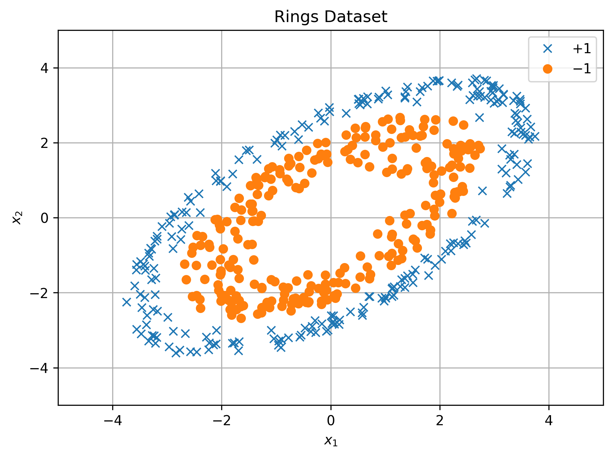

#### Classification Decision Boundaries

The following visualizations compare logistic regression with nonlinear feature transformations.

| Logistic Regression | L2 Norm Features |
|---|---|
| 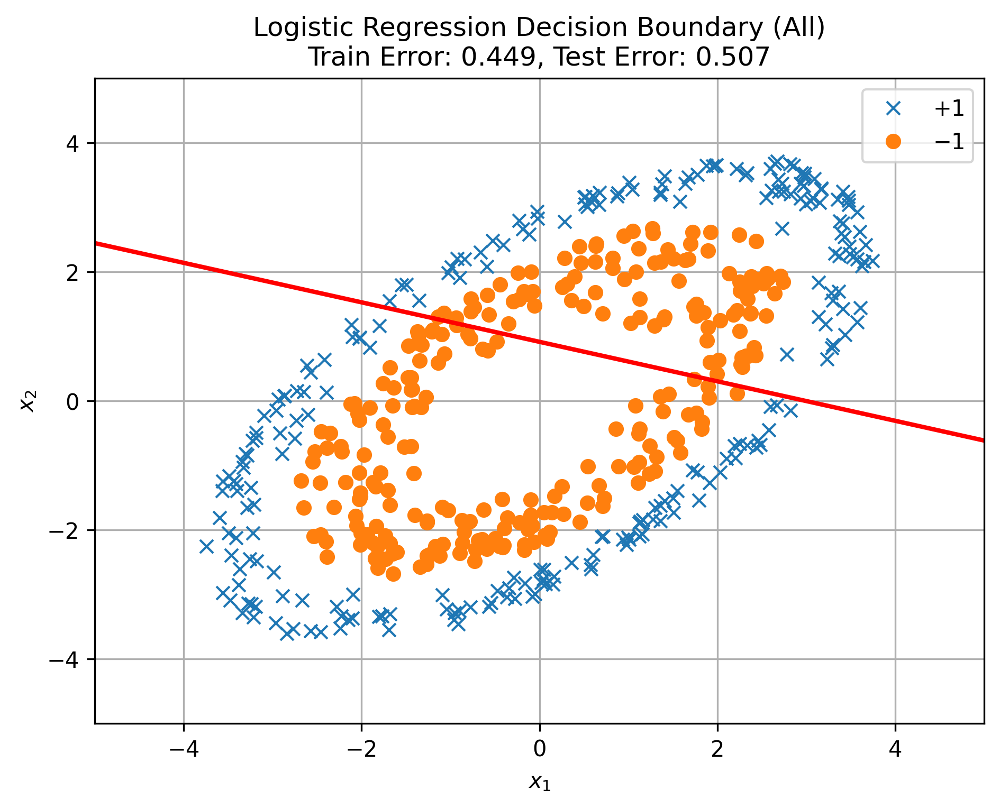 | 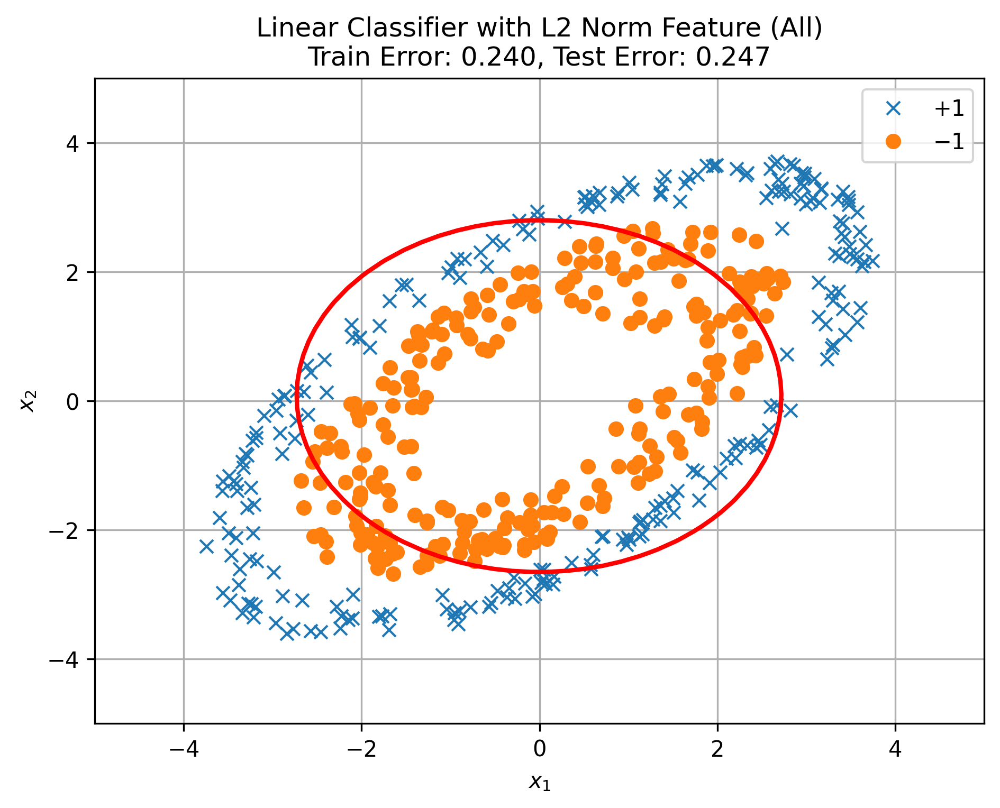 |

| Polynomial Features (Degree 2) |
|---|
| 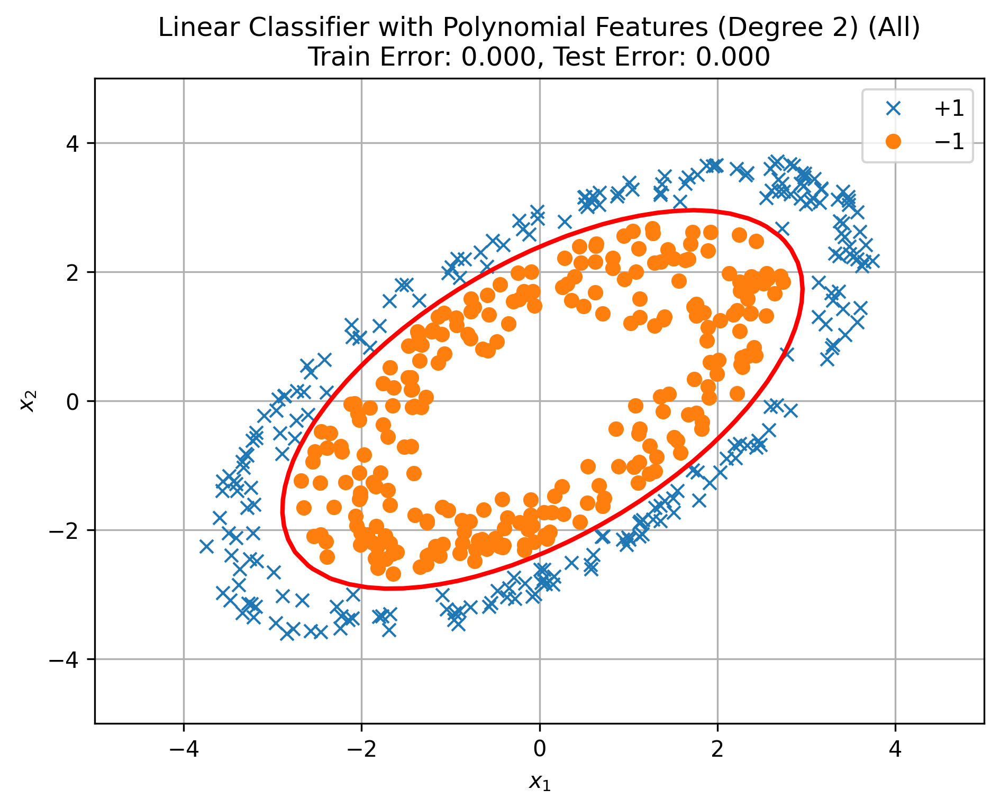 |

#### Test Predictions

Comparing classification results on unseen test data.

| Logistic Regression | Polynomial Features (Degree 2) |
|---|---|
| 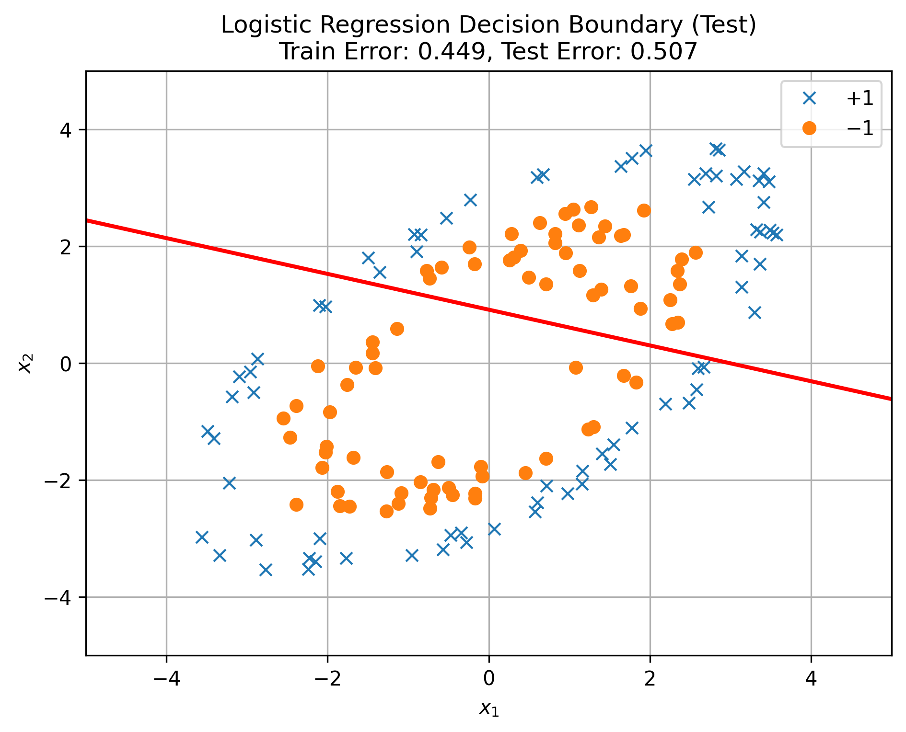 | 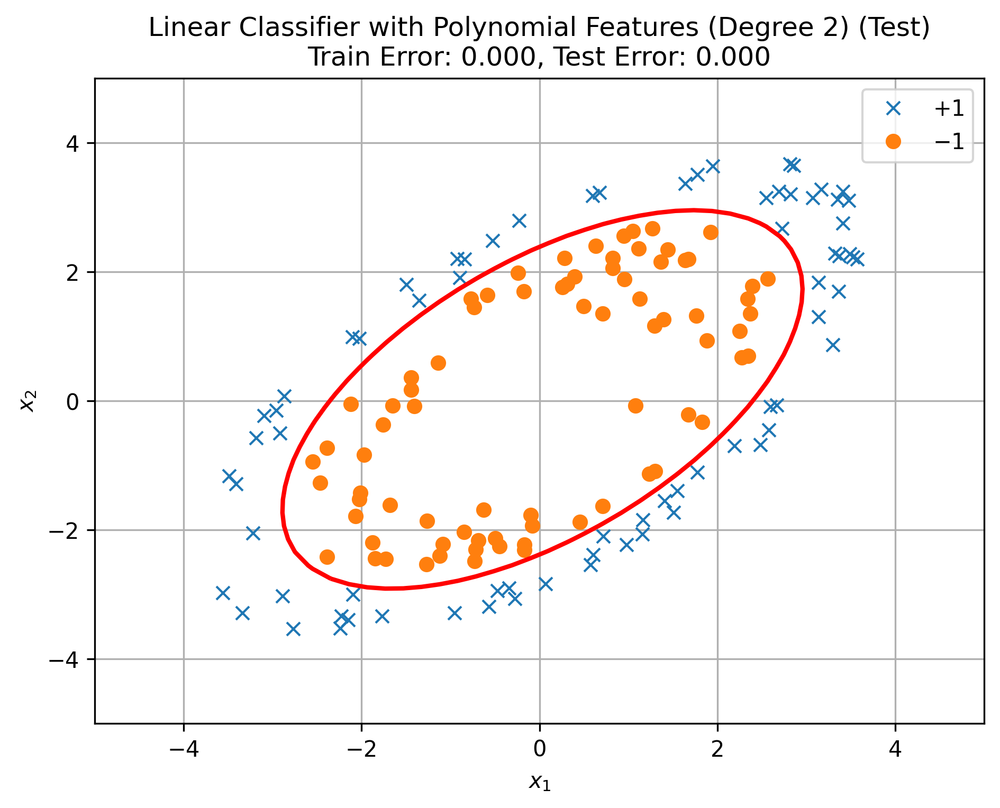 |

### 2. Polynomial Regression

Explores how polynomial degree affects model fitting and generalization, comparing models of degrees 0, 1, 2, and 5.

#### Dataset: poly_s.npz

**Original Dataset**

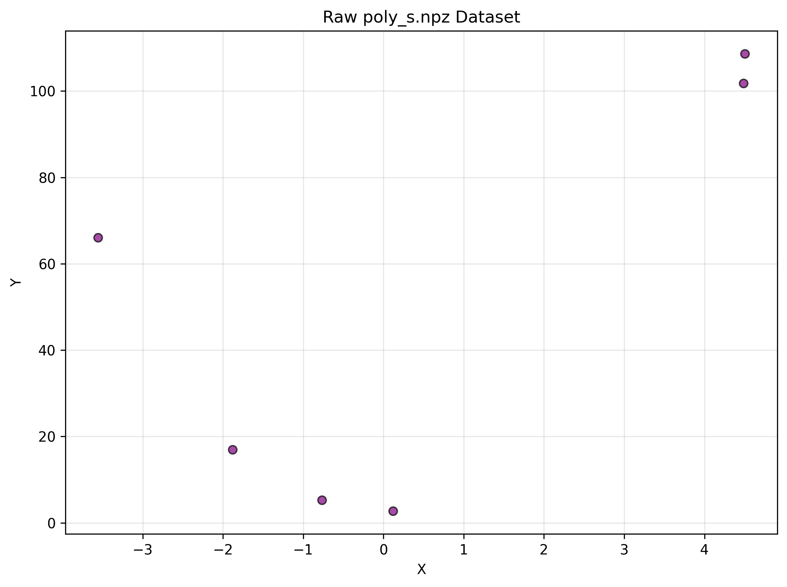

**Polynomial Degree Comparison**

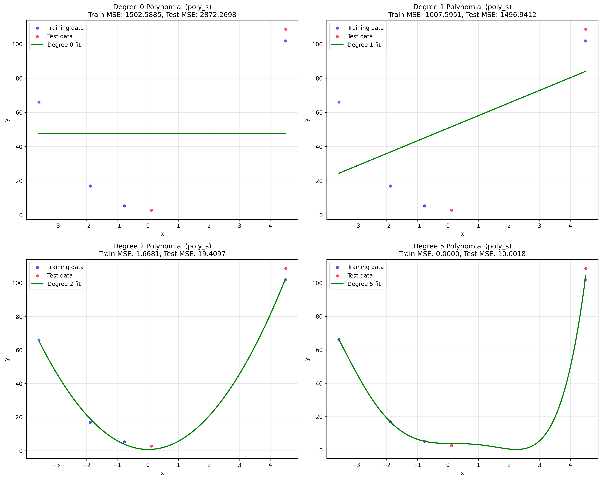

**Training vs Test MSE**

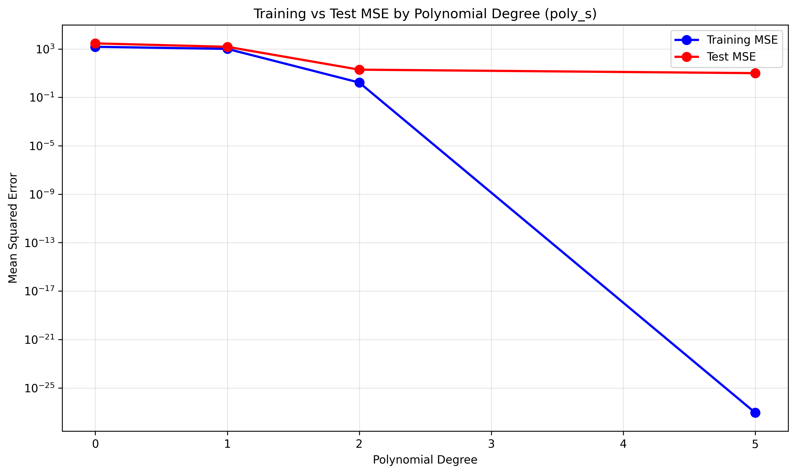

#### Dataset: poly_d.npz

**Original Dataset**

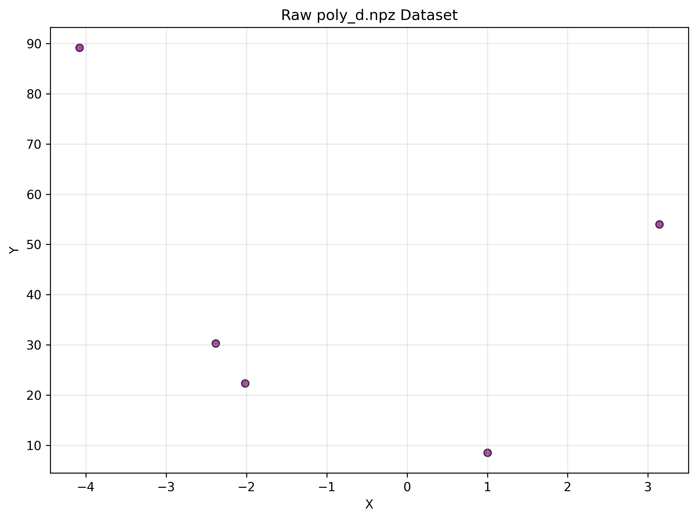

**Polynomial Degree Comparison**

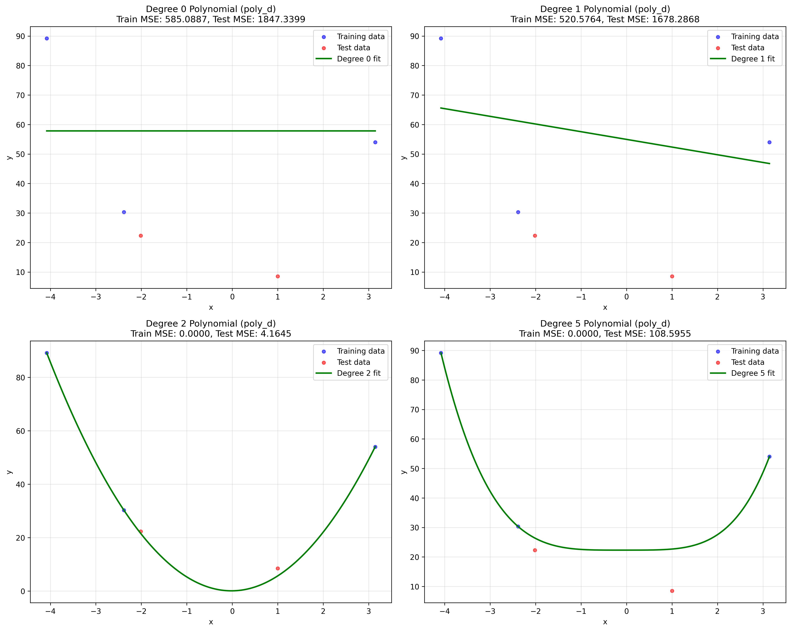

**Training vs Test MSE**

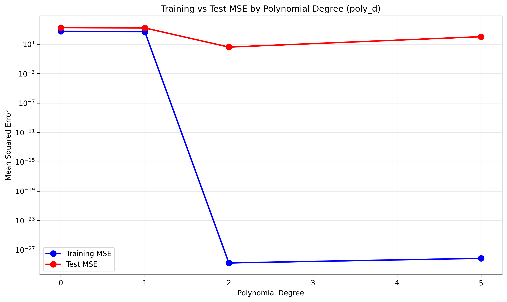

### 3. Additional Model Analysis

#### Degree-2 Polynomial Regression

The following graphs compare training and test predictions for the degree-2 polynomial model on `poly_d.npz`.

| Training Predictions | Test Predictions |
|---|---|
| 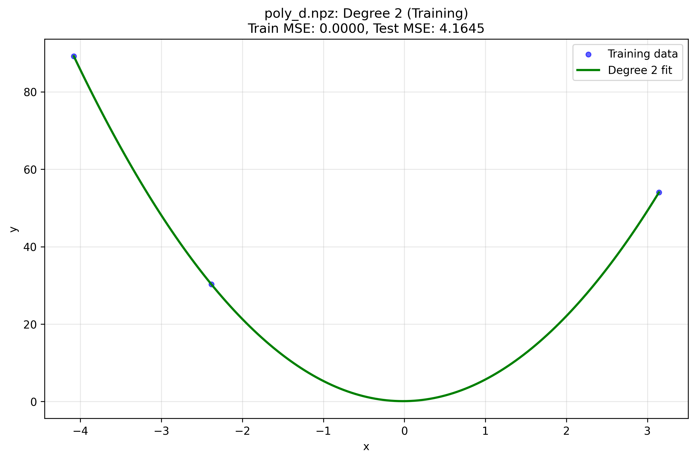 | 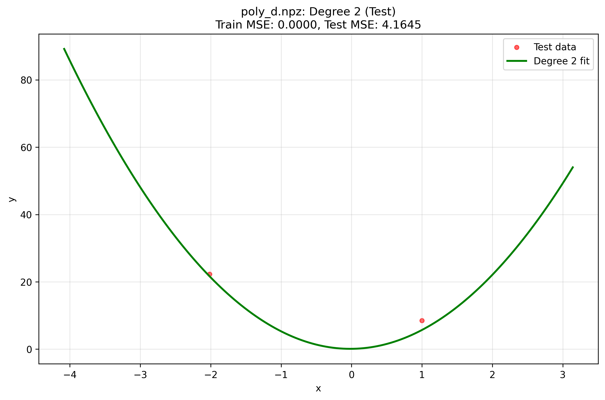 |

## Datasets

| Dataset | Description |
|---|---|
| `rings.npz` | Nonlinear classification using logistic regression and feature engineering |
| `poly_s.npz` | Polynomial regression and model complexity comparison |
| `poly_d.npz` | Polynomial regression with training/test error analysis |

The scripts use a 70/30 training and test split with `random_state=42`.

## Technologies

Python · NumPy · scikit-learn · Matplotlib

## Learning Objectives

Explore nonlinear classification, polynomial feature engineering, model complexity, training and test evaluation, and the effects of underfitting and overfitting through practical machine learning experiments.
